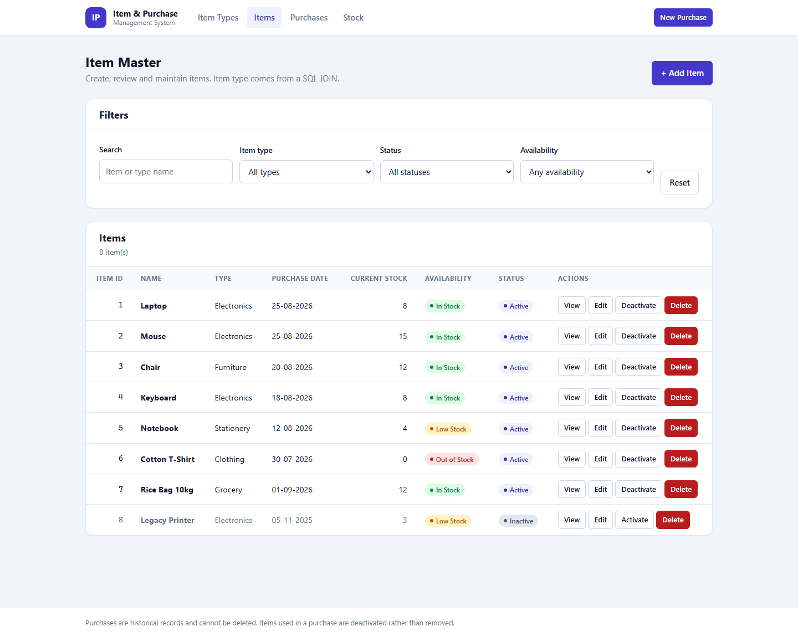
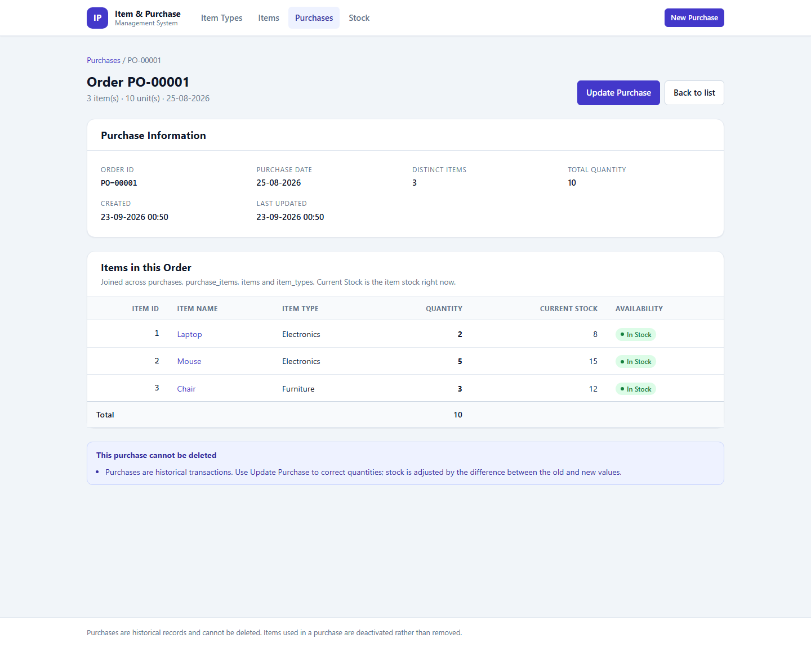

# Item & Purchase Management System

Web application for managing item types, item master data, stock availability and
multi-item purchase orders. Node.js + Express REST API with a dependency-free
frontend.

```
┌──────────────────────────────┐        ┌──────────────────────────────────────┐
│  Frontend (vanilla JS SPA)   │  HTTP  │  Backend (Node.js + Express)         │
│  hash router, 8 screens      │ ─────► │  routes → controllers → validators   │
│  fetch client, no build step │ ◄───── │  → services (business rules)         │
└──────────────────────────────┘  JSON  │  → repositories → MySQL              │
                                        └──────────────────────────────────────┘
```

MySQL is required. All API reads and writes use a MySQL connection pool, and
purchase creation and updates run in database transactions. A schema and
optional demo seed are provided in [`database/`](database).

## Prerequisites

| Software | Version                         |
| -------- | ------------------------------- |
| Node.js  | 18.17 or newer (built on 22.13) |
| npm      | 9 or newer (built on 10.9)      |
| MySQL    | 8.0 or newer                    |

MySQL's client is needed to apply the initial SQL files; no global Node.js tools
or frontend build toolchain are required.

---

## Setup and run

### 1. Confirm MySQL is running

```bash
# Windows (service is usually named MySQL80)
Get-Service MySQL80

# macOS / Linux
mysql --version
```

If the `mysql` client is not on your PATH (common on Windows), call it by full
path, e.g.
`& "C:\Program Files\MySQL\MySQL Server 8.0\bin\mysql.exe" -u root -p`.

### 2. Create the database and tables

The schema creates `item_purchase_db`, the four required relational tables,
and a sequence table used to assign unique order IDs safely.

```bash
# From the project root
mysql -u root -p < database/schema.sql
```

Or from inside the MySQL shell:

```sql
SOURCE database/schema.sql;
```

### 3. Load the sample data (optional)

Reproduces the demo dataset (5 item types, 8 items, Laptop 10 / Mouse 20 /
Chair 15, no purchases).

```bash
mysql -u root -p < database/seed.sql
```

### 4. Verify the schema

```bash
mysql -u root -p -e "USE item_purchase_db; SHOW TABLES; SELECT COUNT(*) AS items FROM items;"
```

Expected: five tables and `items = 8` if you loaded the sample data.

### 5. Configure credentials

Copy the env template and fill in your MySQL details:

```bash
cd backend
cp .env.example .env          # Windows: copy .env.example .env
```

```ini
# backend/.env
PORT=3000

# MySQL connection
DB_HOST=localhost
DB_PORT=3306
DB_USER=root
DB_PASSWORD=your_mysql_password
DB_NAME=item_purchase_db

# Optional: set false to skip adding the demo rows at startup
SEED_DATA=true
```

### 6. Install dependencies and start

```bash
cd backend
npm install
npm start                      # loads backend/.env automatically
```

Open **http://localhost:3000**. Startup verifies connectivity and required
tables; it fails clearly if MySQL is unavailable or the schema has not been
installed. The backend loads `.env` automatically.

### Re-running the schema

`schema.sql` drops and recreates tables, and `seed.sql` truncates and reloads
rows. Re-running either resets existing application data; back up data first.

---

## Running the frontend separately (optional)

`frontend/` is plain static files, so any static server works. CORS is open by
default, and the API base URL can be pointed elsewhere by defining
`window.APP_CONFIG` before `js/app.js` loads:

```html
<script>
  window.APP_CONFIG = { apiBaseUrl: 'http://localhost:3000/api' };
</script>
```

## Configuration

All variables live in `backend/.env` (copy from `backend/.env.example`). Update
the MySQL credentials to match your local server.

| Variable              | Default              | Purpose                                     |
| --------------------- | -------------------- | ------------------------------------------- |
| `PORT`                | `3000`               | HTTP port                                   |
| `CORS_ORIGIN`         | `*`                  | `*` or a comma separated allow-list         |
| `LOW_STOCK_THRESHOLD` | `5`                  | Stock at or below this is "Low Stock"       |
| `SEED_DATA`           | `true`               | Insert missing demo types/items on boot     |
| `LOG_FORMAT`          | `dev`                | morgan format, or `off`                     |
| `DB_HOST`             | `localhost`          | MySQL host                                 |
| `DB_PORT`             | `3306`               | MySQL port                                 |
| `DB_USER`             | `root`               | MySQL user                                 |
| `DB_PASSWORD`         | –                    | MySQL password                             |
| `DB_NAME`             | `item_purchase_db`   | MySQL database name                        |
| `DB_CONNECTION_LIMIT` | `10`                 | Maximum pooled connections                 |

## Project structure

```
backend/
  src/
    server.js                 boot: seed, listen, graceful shutdown
    app.js                    express wiring, static frontend, SPA fallback
    config/env.js             configuration with defaults
    routes/                   URL → controller mapping
    controllers/              HTTP in, HTTP out; no business logic
    validators/               payload/query validation → normalized DTOs
    services/                 business rules, transactions, stock maths
    data/
      mysql.js                connection pool, transactions, health check
      seed.js                 idempotent demo data insertion
      repositories/           all data access, one module per table group
    middleware/               asyncHandler, central error handler, 404
    utils/                    AppError, response envelope, availability rules
frontend/
  index.html                  app shell
  css/styles.css              tokens, layout, components
  js/
    app.js                    route table, view mounting, error boundary
    router.js                 hash router
    api.js                    fetch client, ApiError with field details
    ui.js                     DOM helpers, tables, badges, toasts, dialogs
    views/                    one module per screen
database/
  schema.sql                  MySQL database + 5 tables, keys, constraints
  seed.sql                    sample data (5 types, 8 items, no purchases)
docs/
  API.md                      full API reference
  postman_collection.json     importable request collection
  screenshots/                every screen, captured from the running app
```

### Layering rules

- **Controllers** parse and respond. They never touch the data store.
- **Validators** own field-level rules and produce clean DTOs.
- **Services** own business rules and transaction boundaries.
- **Repositories** own SQL queries and joins for related data.

## Screens

| Screen               | Route                   | Contents                                                        |
| -------------------- | ----------------------- | --------------------------------------------------------------- |
| Item Type Management | `#/item-types`          | Create, rename, delete types; usage counts; delete guard        |
| Item Master          | `#/items`               | Table with filters; view, edit, activate/deactivate, delete     |
| Add / Edit Item      | `#/items/new`, `#/items/:id/edit` | Full form with inline validation messages             |
| Item Details         | `#/items/:id`           | All fields, availability, purchase history, delete eligibility  |
| Purchase List        | `#/purchases`           | Orders with line/quantity totals. View and Update only          |
| Create Purchase      | `#/purchases/new`       | One order, many items; live totals and stock preview            |
| Purchase Details     | `#/purchases/:id`       | Header plus joined item/type/quantity/stock table               |
| Update Purchase      | `#/purchases/:id/edit`  | Edit quantities, add/remove lines, "Stock After" preview        |
| Stock & Availability | `#/stock`               | Summary cards and per-item availability                         |

UI details: responsive layout, sticky header, status/availability badges,
per-field validation messages, toast notifications, accessible confirm dialogs,
keyboard-focusable controls, skip link, `aria-live` announcements and
`aria-invalid` on rejected inputs.

Screenshots of every screen are in [`docs/screenshots/`](docs/screenshots).





## Business rules

### Stock

Stock can never go negative. It is enforced at three levels: the form caps the
quantity, the service validates before writing, and the repository refuses to
persist a negative value.

| Situation                                | Result                                          |
| ---------------------------------------- | ----------------------------------------------- |
| Laptop stock 10, purchase 5              | Allowed, stock becomes 5                        |
| Laptop stock 10, purchase 15             | Rejected `409`, stock untouched                 |
| Purchase quantity 3 → 5                  | Deduct 2 more                                   |
| Purchase quantity 5 → 2                  | Return 3                                        |
| Line removed from an order               | Return the full quantity                        |
| Line added to an existing order          | Deduct the new quantity                         |

### Atomic purchases

Purchase creation and updates run inside a transaction. Every line is validated
first; only then are the purchase, its lines and the stock changes written. Any
failure rolls everything back, so a rejected purchase never leaves a partial
order or a half-applied stock change.

```
BEGIN → validate all items and stock → insert purchase → insert purchase items
      → update stock → COMMIT            (ROLLBACK on any failure)
```

Transactions are serialized, so two concurrent purchases cannot both read the
same stock and overspend it.

### Deletion

| Action                       | Allowed?                                                        |
| ---------------------------- | --------------------------------------------------------------- |
| Delete a purchase            | **Never.** No endpoint, no service function, no UI button. `DELETE` answers `405` |
| Delete an item never purchased | Yes                                                           |
| Delete an item with history  | No — `409`, with a prompt to deactivate instead                 |
| Delete an item type in use   | No — `409`                                                      |

Inactive items stay visible in historical purchase details but are not
selectable for new purchases, and their quantity on an existing order can only
be reduced or removed, never increased.

### Validation

Every rule is enforced on the backend; the frontend mirrors the important ones
for immediate feedback. Errors come back as
`{ field, message }` pairs and are rendered under the matching input.

Required item name · item type must exist · valid purchase date · stock ≥ 0 ·
at least one purchase line · item must exist and be active · quantity > 0 ·
quantity ≤ available stock · no duplicate items in one order · clear errors for
invalid ids and malformed bodies.

See [docs/API.md](docs/API.md) for the complete status code and message table.

## API summary

| Area       | Endpoints                                                                                      |
| ---------- | ---------------------------------------------------------------------------------------------- |
| Item Types | `GET/POST /api/item-types` · `GET/PUT/DELETE /api/item-types/:id`                               |
| Items      | `GET/POST /api/items` · `GET/PUT/DELETE /api/items/:id` · `PATCH /api/items/:id/status`         |
| Purchases  | `GET/POST /api/purchases` · `GET/PUT /api/purchases/:id` · `GET /api/purchases/next-order-id`   |
| Stock      | `GET /api/stock`                                                                               |
| Health     | `GET /api/health`                                                                              |

There is deliberately **no** `DELETE /api/purchases/:id` capability.

## Demo data

Loaded on every boot (`SEED_DATA=true`). Item types: Electronics, Furniture,
Clothing, Grocery, Stationery.

| Item            | Type        | Stock | Status   | Shows           |
| --------------- | ----------- | ----- | -------- | --------------- |
| Laptop          | Electronics | 10    | Active   |                 |
| Mouse           | Electronics | 20    | Active   |                 |
| Chair           | Furniture   | 15    | Active   |                 |
| Keyboard        | Electronics | 8     | Active   |                 |
| Notebook        | Stationery  | 4     | Active   | Low Stock       |
| Cotton T-Shirt  | Clothing    | 0     | Active   | Out of Stock    |
| Rice Bag 10kg   | Grocery     | 12    | Active   |                 |
| Legacy Printer  | Electronics | 3     | Inactive | Not purchasable |

No purchases are seeded, so the walkthrough below starts from a clean history.

## Walkthrough

1. Open **Purchases → Create Purchase**. The Order ID is pre-filled as
   `PO-00001`.
2. Add Laptop × 2, Mouse × 5, Chair × 3. Each line shows its quantity ceiling and
   the stock it will leave behind. Notice that Legacy Printer (inactive) and
   Cotton T-Shirt (zero stock) are not offered.
3. Submit. You land on Purchase Details, and stock is now Laptop 8, Mouse 15,
   Chair 12.
4. Try a second order for 10 Laptops. It is rejected with *Insufficient stock for
   "Laptop". Requested 10, available 8.* and stock stays at 8.
5. Open **Update Purchase** on `PO-00001` and change Laptop from 2 to 5. Stock
   drops to 5. Change it back to 2 and stock returns to 8.
6. Open **Items → Laptop**. Delete is disabled because the item has purchase
   history; deactivating it is offered instead.
7. There is no Delete button on any purchase screen. `DELETE /api/purchases/1`
   answers `405`.

## Database behavior

- The backend uses `mysql2` with a bounded connection pool. Database connection
  settings are loaded from `backend/.env`.
- Every purchase create/update uses a MySQL transaction. Item rows are locked
  with `SELECT ... FOR UPDATE`, and stock deductions are guarded against
  negative values.
- Item/type counts and purchase details are retrieved with SQL joins; the
  purchase detail query joins purchases, purchase items, items, and item types.
- The generated order-ID sequence is protected by a locked database row, so
  concurrent requests do not allocate the same generated ID.
- `GET /api/health` queries MySQL and reports the storage type and record counts.

## Manual validation checklist

- Check `GET /api/health` reports `"storage": "mysql"` and record counts.
- Create a multi-item purchase and confirm its stock deductions in MySQL.
- Try an over-stock purchase and confirm it fails without changing stock.
- Update a purchase quantity and confirm the stock difference is reconciled.
- Confirm purchase details show item names and types from the SQL joins.

## Security note

This API has **no authentication or authorization**. Every endpoint is publicly
callable, and CORS defaults to `*`. That is fine for local development and
review, but before exposing it anywhere shared you would need authentication, a
restricted `CORS_ORIGIN`, and rate limiting on the write endpoints.
